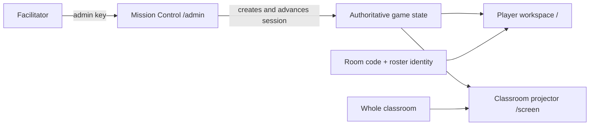

# Search for Luke — Frontend design handoff

This document defines the current frontend surfaces, their audiences, stage visibility, and the interaction contract that must survive a visual redesign.

## 1. Product surfaces and ownership

### A. Join and identity screen — `/`

- **Audience:** every human participant before joining; optional spectators.
- **When visible:** no valid player ID is stored in the browser, or a stored player no longer exists.
- **Primary task:** enter a room code, choose a roster name, or join as a spectator.
- **Must not expose:** clue cards, team board, AI assistant, answers, or facilitator controls.

### B. Player workspace — `/` after identity

- **Audience:** one identified human player or spectator on their own device.
- **When visible:** after a successful join, throughout S0–S9.
- **Desktop structure:** three columns: `Intel / Mission / Comms`.
- **Mobile structure:** the same three areas become tabs; they are not separate routes.
- **Screenshot supplied by the user:** this is the **Player workspace in S2 — First guess**, viewed by an identified non-spectator player.

### C. Classroom projector — `/screen`

- **Audience:** the whole room; displayed on the shared projector or large screen.
- **When visible:** throughout the complete session.
- **Stage behavior:** lobby and QR code in S0; stage instruction, system map, and team progress in S1–S7; animated reveal/results in S8; discussion questions in S9.
- **Must not expose:** a player's private clue cards, private stars before aggregate results, or private AI conversation.

### D. Mission Control — `/admin?key=…`

- **Audience:** facilitator only.
- **When visible:** before, during, and after the session.
- **Primary tasks:** create session, start, pause, resume, skip, monitor rosters/submission counts, export anonymized JSON.
- **Access rule:** requires the admin key; never link it from the player interface.

## 2. Player workspace visibility by stage

| Area | Audience | S0 | S1 | S2 | S3 | S4 | S5 | S6 | S7 | S8 | S9 |
| --- | --- | --- | --- | --- | --- | --- | --- | --- | --- | --- | --- | --- |
| Team identity and roster | Joined player | Yes | Yes | Yes | Yes | Yes | Yes | Yes | Yes | Yes | Yes |
| Private clue cards | Non-spectator | Locked | Yes | Yes | Yes | Yes | Yes | Yes | Yes | Yes | Yes |
| Stage instruction | Joined player | Yes | Yes | Yes | Yes | Yes | Yes | Yes | Yes | Yes | Yes |
| 3D system chart | Joined player | View | View | Pick 3 | View | View | View | Pick 3 | Commander picks 2 | View result | View |
| Read-aloud order | Team player | — | — | — | Yes | — | — | — | — | — | — |
| Team board | Non-spectator | — | — | — | Yes | Yes | Yes | Yes | Yes | — | — |
| Private AI assistant | Human + AI teams | — | — | — | Yes | Yes | Yes | Yes | Yes | Yes | Yes |
| Team rescue result | Joined player | — | — | — | — | — | — | — | — | Yes | Yes |

Spectators can see public stage context and the map, but cannot receive clue cards, submit stars, post to the team board, use the private assistant, or command a drop.

## 3. Required 3D chart interaction

- Reach is the camera pivot and must stay the semantic anchor of the system.
- The default view presents the route in a readable horizontal composition.
- Dragging freely orbits the camera around Reach in three dimensions; the camera is not locked to a horizontal or vertical axis.
- Scroll/pinch zooms toward or away from Reach. Panning the pivot away from Reach is disabled.
- Planets rotate around their own axes.
- Orbital revolution and the future phase model remain out of scope until their rules are approved.
- During S2 and S6, every non-spectator can place three stars; repeated stars on one location are allowed.
- During S7, only the server-selected Drop Commander can choose two distinct drop sites.
- Labels, selection counts, hit targets, reset view, reduced-motion behavior, and the SVG fallback must remain available after redesign.

## 4. Layout problems visible in the current player workspace

1. The fixed desktop columns make the card rail excessively tall while the mission area carries the primary task.
2. The hierarchy does not clearly distinguish persistent context from stage-specific actions.
3. The 3D chart can dominate the viewport after browser zoom, while the submission action becomes visually detached below it.
4. The right communications rail is sparse in early stages but consumes permanent width.
5. The interface does not explicitly label private, team-shared, and classroom-shared information.
6. Selection chips can repeat with identical labels; they need clearer count grouping or stacked-star language.

## 5. Redesign constraints for Cloud/Claude

- Preserve the three information domains: **private Intel**, **stage Mission**, and **team Comms**.
- Make the active stage task the strongest visual region; secondary rails may collapse when empty.
- Keep private/team/classroom visibility explicit in headings or microcopy.
- Do not merge player, projector, and facilitator features into one screen.
- Keep the player route usable at 390 × 844 and at desktop widths without horizontal page scrolling.
- Do not change stage rules, API payloads, roster logic, scoring, or authorization as part of a visual-only pass.
- Treat the 3D chart as the spatial reasoning surface, not as decorative background.

## 6. Recommended player layout direction

- **Header:** mission identity, current stage, countdown.
- **Primary canvas:** stage instruction immediately above the 3D chart; selection status and submit action remain attached to the chart.
- **Intel drawer/rail:** team roster and clue cards; persistent but collapsible on desktop.
- **Comms drawer/rail:** log, team board, and assistant; open automatically only when the current stage introduces new communication work.
- **Mobile:** retain Intel / Mission / Comms tabs, defaulting to the tab that contains the current stage action.

